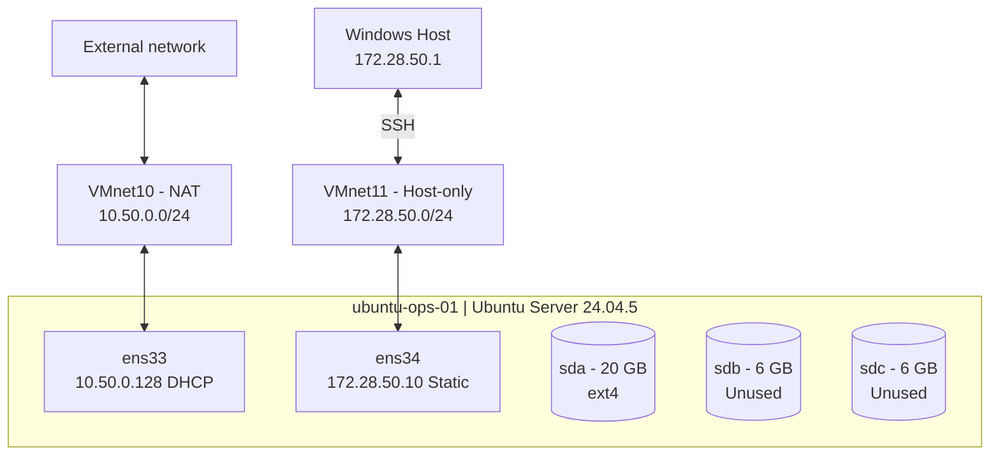

# LAB 01 — Infrastructure Architecture

## Purpose

A single-node Ubuntu Server environment for practicing
Linux service operations, access control, storage management,
systemd, and troubleshooting.

## Infrastructure

| Component | Configuration |
|---|---|
| Hypervisor | VMware Workstation 25H2 |
| VM hostname | ubuntu-ops-01 |
| Operating system | Ubuntu Server 24.04.5 LTS |
| CPU | 2 vCPU |
| Memory | 2 GiB |
| OS disk | 20 GB, ext4 |
| Data disk 1 | 6 GB, unallocated |
| Data disk 2 | 6 GB, unallocated |

## Network Architecture

### NAT — VMnet10

- Interface: ens33
- Subnet: 10.50.0.0/24
- IPv4 assignment: DHCP
- Observed address: 10.50.0.128/24
- Default gateway: 10.50.0.2
- Purpose: package repositories and outbound access

### Management — VMnet11

- Interface: ens34
- Subnet: 172.28.50.0/24
- Static server IP: 172.28.50.10/24
- Windows host IP: 172.28.50.1
- Default gateway: none
- Purpose: SSH administration from Windows

## Storage

The OS uses a dedicated ext4 filesystem.

Two additional 6 GB virtual disks are reserved
for future LVM experiments.

LVM configuration has not yet been implemented.

## Access

- Initial administrative user: ubuntu
- Remote administration: OpenSSH
- SSH password authentication: temporarily enabled
- SSH key authentication: pending configuration
- Additional application/operator roles: pending

## Known Limitations

- Single virtual machine; no high availability
- No redundant storage
- NAT network depends on the VMware host
- VM snapshots are not independent backups
- Management network isolation is not yet fully verified

## Infrastructure Diagram

