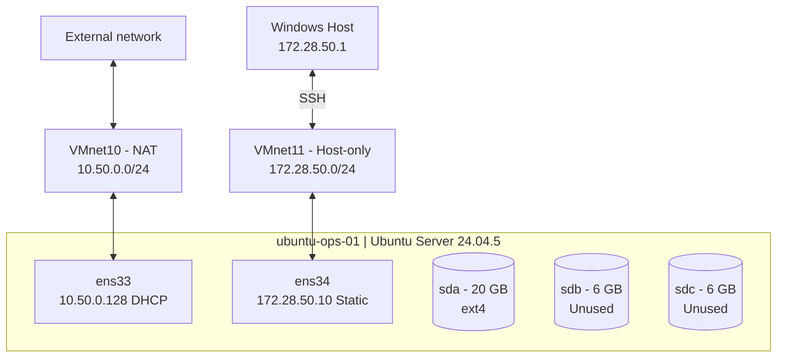

# LAB 01 — Архитектура инфраструктуры

## 1. Назначение

Одноузловая лабораторная инфраструктура на Ubuntu Server предназначена для практического изучения администрирования Linux, управления системными службами, разграничения доступа, работы с хранилищами, systemd и диагностики неисправностей.

Лаборатория моделирует небольшой внутренний сервер компании, обслуживающий служебное API и периодическую задачу формирования отчётов.

Основная цель — получить воспроизводимое окружение с проверяемыми результатами настройки, эксплуатации и восстановления после неисправностей.

## 2. Инфраструктура

| Компонент | Конфигурация |
|---|---|
| Гипервизор | VMware Workstation 25H2 |
| Имя VM | ubuntu-ops-01 |
| Операционная система | Ubuntu Server 24.04.5 LTS |
| Процессор | 2 vCPU |
| Оперативная память | 2 ГиБ |
| Системный диск | 20 ГБ, ext4 |
| Дополнительный диск 1 | 6 ГБ, не размечен |
| Дополнительный диск 2 | 6 ГБ, не размечен |

Лаборатория развёрнута на одной виртуальной машине без графического интерфейса.

Системный диск имеет размер 20 ГБ вместо предусмотренных исходным заданием 18 ГБ. Изменение не влияет на выполнение лабораторных требований.

## 3. Сетевая архитектура

Используются два независимых виртуальных сетевых интерфейса.

### 3.1 NAT — VMnet10

- Интерфейс: `ens33`
- Подсеть: `10.50.0.0/24`
- Способ получения IP: DHCP
- Полученный IP: `10.50.0.128/24`
- Шлюз по умолчанию: `10.50.0.2`
- Назначение: исходящий доступ к сети, репозиториям пакетов и обновлениям

Адрес интерфейса назначается DHCP-сервером VMware и может измениться после обновления аренды.

### 3.2 Management — VMnet11

- Интерфейс: `ens34`
- Тип сети: Host-only
- Подсеть: `172.28.50.0/24`
- IP Ubuntu: `172.28.50.10/24`
- IP Windows Host: `172.28.50.1/24`
- DHCP: отключён
- Шлюз по умолчанию: не задан

Назначение — отдельный административный канал для SSH-подключения с Windows.

Статический IP управляется через Netplan.

### 3.3 Маршрутизация

Маршрут по умолчанию проходит через `ens33`.

Для management-сети используется отдельный маршрут `172.28.50.0/24` через `ens34`.

Таким образом, административное подключение не требует использования адреса NAT-интерфейса.

## 4. Система хранения

Операционная система размещена на диске `/dev/sda`.

Корневая файловая система использует ext4 и монтируется в `/`.

Два дополнительных диска:

- `/dev/sdb` — 6 ГБ
- `/dev/sdc` — 6 ГБ

Зарезервированы для дальнейшего изучения LVM.

На текущем этапе они не размечены, не отформатированы и не используются для хранения данных.

В следующих этапах запланированы создание Physical Volume, Volume Group, Logical Volume и проверка расширения файловой системы с сохранением контрольных данных.

## 5. Управление доступом

Текущая конфигурация:

- Административный пользователь: `ubuntu`
- Удалённое управление: OpenSSH
- Членство пользователя в группе `sudo`: подтверждено
- Авторизация по SSH-ключам: ещё не настроена
- Авторизация по паролю SSH: временно разрешена

Планируется настройка дополнительных пользователей, групп, ограниченных sudo-полномочий и аутентификации по SSH-ключам.

## 6. Проверенное состояние

Успешно подтверждены:

- Установка Ubuntu Server 24.04.5 LTS
- Наличие трёх виртуальных дисков
- Получение IP-адреса по DHCP на `ens33`
- Статическая адресация `ens34`
- Сохранение сетевых настроек после перезагрузки
- Работа службы SSH после перезагрузки
- Подключение из Windows к серверу по SSH
- Создание локального Git-репозитория

Доступ к внешним репозиториям через NAT требует отдельной проверки.

## 7. Известные ограничения

- Используется одна виртуальная машина без высокой доступности.
- Нет резервирования виртуальных дисков.
- Работоспособность NAT зависит от VMware и хостовой системы.
- Snapshot виртуальной машины не заменяет независимый backup.
- Сетевая изоляция management-сегмента ещё не прошла полную проверку.
- Хранилище LVM и прикладная служба ещё не реализованы.

Лабораторный стенд моделирует инженерные практики эксплуатации и не заявляется как отказоустойчивая production-инфраструктура.

## Схема инфраструктуры

