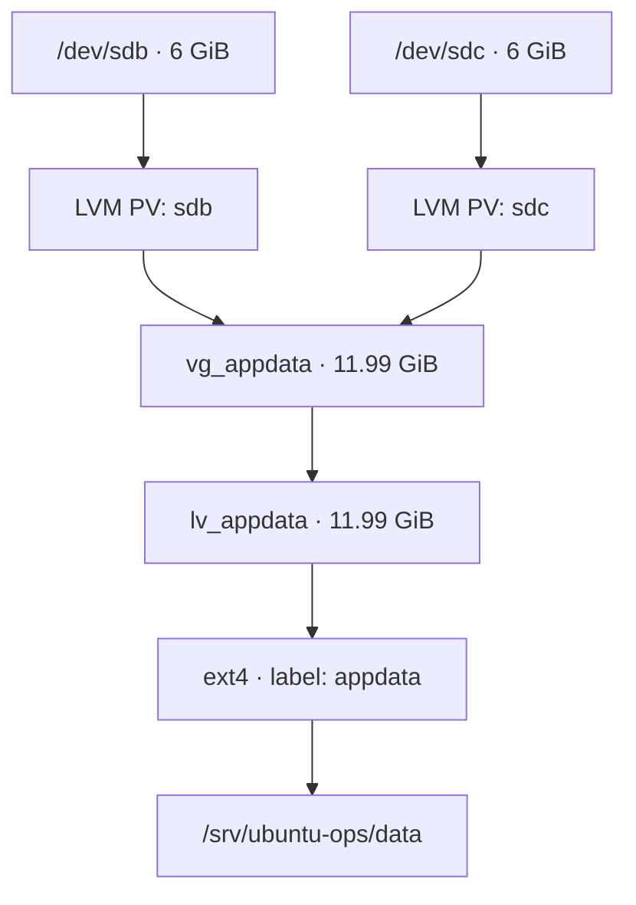

# LAB 01 — LVM Storage Operations

## Purpose and outcome

This lab provisions an ext4 filesystem on LVM, configures persistent mounting, expands the storage online using a second virtual disk, and checks data integrity before and after expansion and reboot.

**Verified result:** `vg_appdata` contains two physical volumes (`/dev/sdb`, `/dev/sdc`), and `lv_appdata` is **11.99 GiB**. The ext4 filesystem remains mounted at `/srv/ubuntu-ops/data`; a 32 MiB test file passes SHA-256 verification after online expansion and reboot.

## Lab environment

| Component | Configuration |
| --- | --- |
| Platform | VMware Workstation, Ubuntu Server 24.04.5 LTS |
| VM | `ubuntu-ops-01` |
| OS disk | `/dev/sda` — 20 GiB (system filesystem, **not modified**) |
| Initial LVM disk | `/dev/sdb` — 6 GiB |
| Expansion disk | `/dev/sdc` — 6 GiB |
| Volume group | `vg_appdata` |
| Logical volume | `lv_appdata` |
| Filesystem | ext4; label `appdata` |
| Mount point | `/srv/ubuntu-ops/data` |
| ext4 UUID | `b165eaa1-ce80-44a6-a4f7-7e168af23b66` |

### Storage layout



**Important:** This layout spans two disks to increase capacity. It is **not RAID, replication, or redundancy**. A failure of either contributing disk may render the logical volume and filesystem unavailable. Backups are still required.

## 1. Inspect disks and prepare the initial physical volume

Run these commands only after confirming the correct devices with `lsblk`. Creating a PV writes LVM metadata to the selected device; never run this against the OS disk.

```bash
lsblk -o NAME,SIZE,TYPE,FSTYPE,MOUNTPOINTS
sudo wipefs -n /dev/sdb       # read-only signature inspection
sudo pvcreate /dev/sdb
sudo vgcreate vg_appdata /dev/sdb
sudo pvs
sudo vgs
```

`/dev/sda` contains the operating system and must not be repartitioned or formatted for this exercise.

## 2. Create the logical volume and ext4 filesystem

```bash
sudo lvcreate -n lv_appdata -l 100%FREE vg_appdata
sudo lvs -o lv_name,vg_name,lv_size,lv_attr,devices
sudo mkfs.ext4 -L appdata /dev/vg_appdata/lv_appdata
sudo blkid /dev/vg_appdata/lv_appdata
```

The initial LV occupied approximately 6 GiB on `/dev/sdb`. `mkfs.ext4` is destructive to existing contents of its target; it was run only on the newly created, empty LV.

## 3. Mount ext4 and make the mount persistent

```bash
sudo mkdir -p /srv/ubuntu-ops/data
sudo ls -la /srv/ubuntu-ops/data  # confirm there are no files to obscure
sudo mount /dev/vg_appdata/lv_appdata /srv/ubuntu-ops/data
findmnt /srv/ubuntu-ops/data
sudo cp -a /etc/fstab /etc/fstab.bak.lab01
```

One entry was added to `/etc/fstab` (do not add it twice):

```fstab
UUID=b165eaa1-ce80-44a6-a4f7-7e168af23b66 /srv/ubuntu-ops/data ext4 defaults 0 2
```

The UUID identifies the filesystem independently of the kernel's disk-name ordering. `defaults` uses standard mount options; `0` disables the legacy `dump` backup setting; `2` sets the filesystem check ordering after the root filesystem.

```bash
sudo findmnt --verify --verbose
sudo systemctl daemon-reload
sudo umount /srv/ubuntu-ops/data
sudo mount /srv/ubuntu-ops/data  # resolve source and options from fstab
findmnt /srv/ubuntu-ops/data
```

Verification returned zero parse errors and zero errors. The warning about `/swap.img` being a regular file concerned the existing swap-file entry, not the LVM mount. Mounting was also verified after a reboot.

## 4. Create an integrity baseline before expansion

A random 32 MiB file was created on the mounted ext4 filesystem. Its SHA-256 digest was saved **outside the test filesystem**, in the Git repository.

```bash
sudo dd if=/dev/urandom \
  of=/srv/ubuntu-ops/data/lvm-integrity-test.bin \
  bs=1M count=32 status=progress conv=fsync

cd ~/projects/ubuntu-ops-field-lab
sudo sha256sum /srv/ubuntu-ops/data/lvm-integrity-test.bin \
  | tee docs/evidence/storage-before-expand.sha256
sudo sha256sum -c docs/evidence/storage-before-expand.sha256
```

Expected verification: `/srv/ubuntu-ops/data/lvm-integrity-test.bin: OK`.

## 5. Add a second physical volume and expand the VG

Inspect the second disk before modifying it. In this lab `/dev/sdc` was a separate, unused 6 GiB device, with no filesystem signatures detected by `wipefs -n`.

```bash
lsblk -o NAME,SIZE,TYPE,FSTYPE,MOUNTPOINTS
sudo wipefs -n /dev/sdc       # does not erase data
sudo pvs                     # initially lists only /dev/sdb
sudo pvcreate /dev/sdc
sudo pvs                     # /dev/sdc appears without a VG
sudo vgextend vg_appdata /dev/sdc
sudo pvs
sudo vgs
sudo lvs
```

At this point the VG was **11.99 GiB**, with approximately 6 GiB free, while the LV was still approximately 6 GiB.

## 6. Grow the LV and ext4 online

```bash
sudo lvextend -r -l +100%FREE /dev/vg_appdata/lv_appdata
sudo lvs
findmnt /srv/ubuntu-ops/data
df -hT /srv/ubuntu-ops/data
sudo sha256sum -c docs/evidence/storage-before-expand.sha256
```

`-l +100%FREE` adds the VG's remaining free extents; `-r` also grows the filesystem using the appropriate filesystem tool (`resize2fs` for ext4). The filesystem stayed mounted throughout the expansion.

The command reported growth from **1535 to 3070 extents** and online ext4 resizing to **3,143,680 blocks of 4 KiB**. `lvs` reported **11.99 GiB**; `df -hT` rounded the filesystem size to **12G**. The SHA-256 check returned **OK**.

## 7. Verify persistence and integrity after reboot

After `sudo reboot` and reconnecting to Ubuntu, the following checks passed:

```bash
cd ~/projects/ubuntu-ops-field-lab
findmnt /srv/ubuntu-ops/data
sudo pvs
sudo vgs
sudo lvs
df -hT /srv/ubuntu-ops/data
sudo sha256sum -c docs/evidence/storage-before-expand.sha256
```

| Check | Observed result |
| --- | --- |
| Physical volumes | `/dev/sdb` and `/dev/sdc` in `vg_appdata` |
| Volume group | 2 PV, 1 LV; 11.99 GiB total; 0 free extents |
| Logical volume | `lv_appdata` at 11.99 GiB |
| Persistent mount | `/srv/ubuntu-ops/data`, ext4, `rw,relatime` |
| Filesystem capacity | `12G` shown by `df -hT`; approximately 33 MiB used |
| Integrity | `lvm-integrity-test.bin: OK` after reboot |

The checksum verifies the contents of the **test file**, not every byte on the filesystem. It is an integrity check, not a substitute for backup or broader storage testing.

## Evidence files

All evidence is kept in the repository's `docs/evidence/` directory:

| File | Evidence |
| --- | --- |
| `storage-before-lvm.txt` | Baseline disk/storage observations before LVM operations |
| `storage-before-expand.sha256` | SHA-256 of the 32 MiB integrity test file |
| `storage-after-expand.txt` | PV/VG/LV, mount, filesystem capacity, and checksum after online expansion |
| `storage-post-reboot.txt` | PV/VG/LV, mount, capacity, and checksum after reboot |

The test data itself lives on the mounted LVM volume, not in Git.

## Operational notes

- Confirm device names and signatures before any `pvcreate` or `mkfs` operation. Both can destroy data if run on the wrong target.
- Keep a backup copy of `/etc/fstab`, verify it, and test mounting before rebooting.
- Use `pvs`, `vgs`, `lvs`, `findmnt`, `df -hT`, and `sha256sum -c` to validate the whole storage chain.
- Extending a filesystem does not add fault tolerance. Keep backups and plan recovery separately.
- Do not commit private SSH keys, access tokens, or other secrets in documentation or evidence.

**Status:** LVM provisioning, persistent mounting, online expansion, checksum verification, and post-reboot verification — **PASS**.
