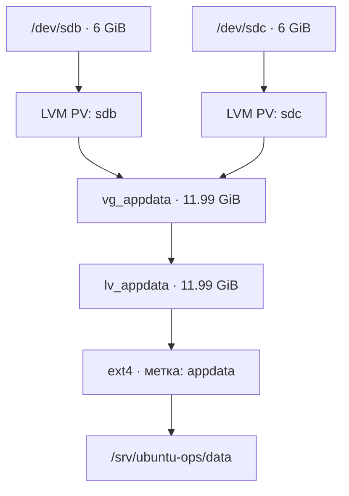

# LAB 01 — Работа с хранилищем LVM

## Цель и результат

В этой лабораторной работе мы создаём файловую систему ext4 поверх LVM, настраиваем постоянное монтирование, расширяем хранилище без размонтирования с помощью второго виртуального диска и проверяем целостность данных до и после расширения, включая перезагрузку сервера.

**Подтверждённый результат:** в `vg_appdata` входят два физических тома (`/dev/sdb`, `/dev/sdc`), а размер `lv_appdata` составляет **11.99 GiB**. Файловая система ext4 смонтирована в `/srv/ubuntu-ops/data`; проверка SHA-256 тестового файла размером 32 MiB успешна после расширения и перезагрузки.

## Окружение лабораторной работы

| Компонент | Конфигурация |
| --- | --- |
| Платформа | VMware Workstation, Ubuntu Server 24.04.5 LTS |
| Виртуальная машина | `ubuntu-ops-01` |
| Системный диск | `/dev/sda` — 20 GiB (ОС, **не изменялся**) |
| Первый диск LVM | `/dev/sdb` — 6 GiB |
| Диск для расширения | `/dev/sdc` — 6 GiB |
| Группа томов | `vg_appdata` |
| Логический том | `lv_appdata` |
| Файловая система | ext4, метка `appdata` |
| Точка монтирования | `/srv/ubuntu-ops/data` |
| UUID ext4 | `b165eaa1-ce80-44a6-a4f7-7e168af23b66` |

### Схема хранилища



**Важно:** объединение двух дисков увеличивает ёмкость, но **не создаёт RAID, репликацию или отказоустойчивость**. Отказ любого из дисков может привести к недоступности логического тома и файловой системы. Резервное копирование по-прежнему необходимо.

## 1. Проверка дисков и создание первого Physical Volume

Перед командами, изменяющими разметку или метаданные, обязательно проверить устройства через `lsblk`. `pvcreate` записывает метаданные LVM на указанный диск; выполнять её для системного диска нельзя.

```bash
lsblk -o NAME,SIZE,TYPE,FSTYPE,MOUNTPOINTS
sudo wipefs -n /dev/sdb       # проверка сигнатур без изменений
sudo pvcreate /dev/sdb
sudo vgcreate vg_appdata /dev/sdb
sudo pvs
sudo vgs
```

На `/dev/sda` находится операционная система. В этой лабораторной мы не переразмечаем и не форматируем этот диск.

## 2. Создание логического тома и ext4

```bash
sudo lvcreate -n lv_appdata -l 100%FREE vg_appdata
sudo lvs -o lv_name,vg_name,lv_size,lv_attr,devices
sudo mkfs.ext4 -L appdata /dev/vg_appdata/lv_appdata
sudo blkid /dev/vg_appdata/lv_appdata
```

Исходный размер LV составлял примерно 6 GiB на `/dev/sdb`. `mkfs.ext4` уничтожает прежнюю структуру данных на целевом устройстве, поэтому команда выполнялась только на новом пустом LV.

## 3. Монтирование ext4 и настройка `/etc/fstab`

```bash
sudo mkdir -p /srv/ubuntu-ops/data
sudo ls -la /srv/ubuntu-ops/data  # убеждаемся, что нет файлов, которые будут скрыты монтированием
sudo mount /dev/vg_appdata/lv_appdata /srv/ubuntu-ops/data
findmnt /srv/ubuntu-ops/data
sudo cp -a /etc/fstab /etc/fstab.bak.lab01
```

В `/etc/fstab` добавлена **одна** запись (не нужно добавлять её повторно):

```fstab
UUID=b165eaa1-ce80-44a6-a4f7-7e168af23b66 /srv/ubuntu-ops/data ext4 defaults 0 2
```

UUID позволяет найти конкретную файловую систему независимо от порядка имён дисков. `defaults` — стандартные параметры монтирования; `0` отключает устаревший параметр `dump`; `2` задаёт порядок проверки файловой системы после корневого раздела.

```bash
sudo findmnt --verify --verbose
sudo systemctl daemon-reload
sudo umount /srv/ubuntu-ops/data
sudo mount /srv/ubuntu-ops/data  # параметры берутся из fstab
findmnt /srv/ubuntu-ops/data
```

Проверка вернула ноль ошибок и ноль ошибок синтаксиса. Предупреждение о том, что `/swap.img` является обычным файлом, относилось к существующему swap-файлу, а не к LVM. После перезагрузки монтирование также подтвердилось.

## 4. Создание контрольных данных перед расширением

На смонтированной ext4 создан файл со случайными данными размером 32 MiB. Его SHA-256 сохранён **за пределами тестовой файловой системы** — внутри Git-репозитория.

```bash
sudo dd if=/dev/urandom \
  of=/srv/ubuntu-ops/data/lvm-integrity-test.bin \
  bs=1M count=32 status=progress conv=fsync

cd ~/projects/ubuntu-ops-field-lab
sudo sha256sum /srv/ubuntu-ops/data/lvm-integrity-test.bin \
  | tee docs/evidence/storage-before-expand.sha256
sudo sha256sum -c docs/evidence/storage-before-expand.sha256
```

Ожидаемый результат: `/srv/ubuntu-ops/data/lvm-integrity-test.bin: OK`.

## 5. Добавление второго PV и расширение Volume Group

Перед изменением второго диска проверяем его состояние. В нашем случае `/dev/sdc` — отдельный неиспользуемый диск объёмом 6 GiB; команда `wipefs -n` не обнаружила на нём сигнатур файловых систем.

```bash
lsblk -o NAME,SIZE,TYPE,FSTYPE,MOUNTPOINTS
sudo wipefs -n /dev/sdc       # ничего не стирает
sudo pvs                     # до добавления виден только /dev/sdb
sudo pvcreate /dev/sdc
sudo pvs                     # /dev/sdc пока без VG
sudo vgextend vg_appdata /dev/sdc
sudo pvs
sudo vgs
sudo lvs
```

На этом этапе размер VG вырос до **11.99 GiB**, около 6 GiB оставалось свободно, а размер LV по-прежнему был около 6 GiB.

## 6. Увеличение LV и ext4 без размонтирования

```bash
sudo lvextend -r -l +100%FREE /dev/vg_appdata/lv_appdata
sudo lvs
findmnt /srv/ubuntu-ops/data
df -hT /srv/ubuntu-ops/data
sudo sha256sum -c docs/evidence/storage-before-expand.sha256
```

`-l +100%FREE` добавляет всё свободное пространство группы, а `-r` автоматически увеличивает файловую систему соответствующей утилитой (`resize2fs` для ext4). Во время расширения файловая система оставалась смонтированной.

Команда показала увеличение с **1535 до 3070 экстентов** и расширение ext4 online до **3 143 680 блоков по 4 KiB**. `lvs` показал **11.99 GiB**, а `df -hT` округлил размер файловой системы до **12G**. Проверка SHA-256 вернула **OK**.

## 7. Проверка после перезагрузки

После `sudo reboot` и повторного подключения к Ubuntu успешно выполнены:

```bash
cd ~/projects/ubuntu-ops-field-lab
findmnt /srv/ubuntu-ops/data
sudo pvs
sudo vgs
sudo lvs
df -hT /srv/ubuntu-ops/data
sudo sha256sum -c docs/evidence/storage-before-expand.sha256
```

| Проверка | Фактический результат |
| --- | --- |
| Physical Volumes | `/dev/sdb` и `/dev/sdc` в `vg_appdata` |
| Volume Group | 2 PV, 1 LV; всего 11.99 GiB; свободных экстентов нет |
| Logical Volume | `lv_appdata`, 11.99 GiB |
| Постоянное монтирование | `/srv/ubuntu-ops/data`, ext4, `rw,relatime` |
| Размер файловой системы | `12G` в `df -hT`, занято около 33 MiB |
| Целостность | `lvm-integrity-test.bin: OK` после reboot |

Контрольная сумма проверяет содержимое **конкретного тестового файла**, а не каждый байт файловой системы. Это проверка целостности, а не замена резервного копирования и комплексного тестирования дисков.

## Файлы с доказательствами (evidence)

Все результаты сохраняются в каталоге репозитория `docs/evidence/`:

| Файл | Что подтверждает |
| --- | --- |
| `storage-before-lvm.txt` | Исходное состояние дисков и хранилища до настройки LVM |
| `storage-before-expand.sha256` | SHA-256 тестового файла размером 32 MiB |
| `storage-after-expand.txt` | PV/VG/LV, монтирование, объём ext4 и SHA-256 после расширения |
| `storage-post-reboot.txt` | PV/VG/LV, монтирование, объём ext4 и SHA-256 после перезагрузки |

Сам тестовый файл хранится на LVM-томе и **не добавляется в Git**.

## Эксплуатационные замечания

- Проверяйте имена устройств и сигнатуры перед `pvcreate` и `mkfs`: ошибка в выборе устройства может уничтожить данные.
- Создавайте резервную копию `/etc/fstab`, проверяйте конфигурацию и тестируйте монтирование перед перезагрузкой.
- Проверяйте всю цепочку хранения через `pvs`, `vgs`, `lvs`, `findmnt`, `df -hT` и `sha256sum -c`.
- Расширение файловой системы не создаёт отказоустойчивость. Резервные копии и восстановление необходимо проектировать отдельно.
- Не сохраняйте приватные SSH-ключи, токены или другие секреты в документации и evidence-файлах.

**Статус:** создание LVM, постоянное монтирование, online-расширение, проверка SHA-256 и проверка после перезагрузки — **PASS**.
