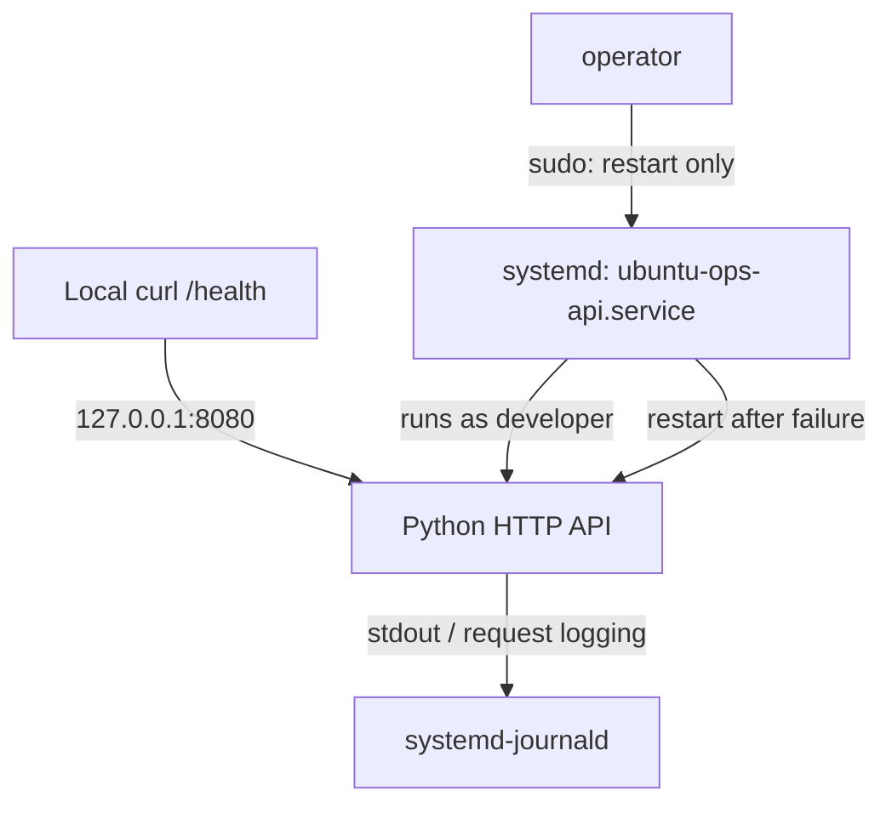

# LAB 01 — systemd Service Operations

## Purpose and verified outcome

This lab deploys a minimal Python HTTP API on Ubuntu Server, runs it as a non-root systemd service, enables startup after reboot, inspects journald logs, validates a narrowly scoped operator sudo rule, and demonstrates automatic recovery from a forced process failure.

**Verified result (2026-10-14):** `ubuntu-ops-api.service` started automatically after reboot, served `GET /health` with HTTP **200**, and recovered from `SIGKILL` with `NRestarts=1`. The `operator` account was permitted to restart this service, but was denied permission to stop it or run an arbitrary command as root.

## Lab environment

| Component | Configuration |
| --- | --- |
| Platform | VMware Workstation; Ubuntu Server 24.04.5 LTS |
| VM | `ubuntu-ops-01` |
| Python | 3.12.3 (standard library only) |
| Service name | `ubuntu-ops-api.service` |
| Bind address | `127.0.0.1:8080` (loopback only) |
| Health endpoint | `GET /health` |
| Runtime account | `developer`, primary service group `app-developers` |
| Operator account | `operator` (limited sudo permission) |
| Installed application | `/srv/ubuntu-ops/app/ubuntu_ops_api.py` |
| Installed unit | `/etc/systemd/system/ubuntu-ops-api.service` |
| Unit behavior | `Restart=on-failure`, `RestartSec=3` |

## Architecture



The API listens **only on loopback**. The host-only SSH/UFW network policy does not need a new inbound rule for port 8080. This endpoint is for local lab checks, not an externally exposed production API.

## Repository layout

| Tracked file | Purpose |
| --- | --- |
| [`app/ubuntu_ops_api.py`](../app/ubuntu_ops_api.py) | HTTP server source |
| [`configs/systemd/ubuntu-ops-api.service`](../configs/systemd/ubuntu-ops-api.service) | Version-controlled systemd unit |
| [`configs/sudoers/ubuntu-ops-operator`](../configs/sudoers/ubuntu-ops-operator) | Previously configured operator sudo policy |
| [`docs/evidence/systemd-operator.txt`](evidence/systemd-operator.txt) | Allowed/denied sudo checks |
| [`docs/evidence/systemd-recovery.txt`](evidence/systemd-recovery.txt) | Recovery, health, and journal observations |

The source code and the copy of the unit in Git are distinct from the **installed** files under `/srv` and `/etc`. Editing a repository file does not update a running service automatically.

## 1. Create and inspect the application

The Python application uses `ThreadingHTTPServer` and `BaseHTTPRequestHandler` from the standard library. `GET /health` returns HTTP `200` and the JSON body:

```json
{"status": "ok", "service": "ubuntu-ops-api"}
```

Other GET paths return HTTP `404` with `{"error": "not found"}`. The code intentionally binds to `127.0.0.1` on port `8080`; it needs no third-party Python dependencies. A syntax check was performed using `ast.parse()`.

```bash
cd ~/projects/ubuntu-ops-field-lab
python3 --version
python3 - <<'PY'
import ast
from pathlib import Path
ast.parse(Path('app/ubuntu_ops_api.py').read_text())
print('PASS: Python syntax is valid')
PY
```

## 2. Install the application with restricted access

The pre-existing application directory is owned by `root:app-developers` and has mode `2770` (setgid). The installed source file is `root:app-developers`, mode `0640`.

```bash
sudo install -o root -g app-developers -m 0640 \
  app/ubuntu_ops_api.py /srv/ubuntu-ops/app/ubuntu_ops_api.py
sudo ls -ld /srv/ubuntu-ops/app
sudo ls -l /srv/ubuntu-ops/app/ubuntu_ops_api.py
id developer
sudo -u developer test -r /srv/ubuntu-ops/app/ubuntu_ops_api.py \
  && echo 'PASS: developer can read application'
```

The ordinary `ubuntu` user received `Permission denied` when listing the installed file without sudo, while `developer` could read it through group membership. The service does not require root privileges to read or execute the Python script via `/usr/bin/python3`.

**Security caveat:** mode `2770` makes the directory group-writable. A member of `app-developers` may be able to rename or replace a file within that directory even when the file itself is owned by root and mode `0640`. For production, separate deployment ownership from runtime access; do not treat the current directory permissions as tamper-proof.

## 3. Install and validate the systemd unit

The version-controlled unit corresponds to `/etc/systemd/system/ubuntu-ops-api.service`:

```ini
[Unit]
Description=Ubuntu Ops LAB 01 HTTP API
After=network.target

[Service]
Type=simple
User=developer
Group=app-developers
WorkingDirectory=/srv/ubuntu-ops/app
ExecStart=/usr/bin/python3 /srv/ubuntu-ops/app/ubuntu_ops_api.py
Restart=on-failure
RestartSec=3

NoNewPrivileges=true
PrivateTmp=true
ProtectSystem=strict
ProtectHome=true
Environment=PYTHONDONTWRITEBYTECODE=1

[Install]
WantedBy=multi-user.target
```

`User` and `Group` drop root execution privileges. `Restart=on-failure` restarts the main process when it fails; `RestartSec=3` inserts a delay. The hardening options restrict privilege escalation, temporary-directory visibility, and filesystem access. `PYTHONDONTWRITEBYTECODE=1` avoids writing Python bytecode into the application directory.

On a fresh lab VM where the account and application path already exist, install the tracked unit and reload systemd:

```bash
sudo install -o root -g root -m 0644 \
  configs/systemd/ubuntu-ops-api.service \
  /etc/systemd/system/ubuntu-ops-api.service
sudo systemd-analyze verify /etc/systemd/system/ubuntu-ops-api.service
sudo systemctl daemon-reload
systemctl show ubuntu-ops-api.service -p LoadState -p User -p Group -p ExecStart
```

In the actual lab, unit validation produced no errors and `LoadState=loaded`, `User=developer`, `Group=app-developers`.

## 4. Run the service and check HTTP health

```bash
sudo systemctl start ubuntu-ops-api.service
systemctl is-active ubuntu-ops-api.service
systemctl status ubuntu-ops-api.service --no-pager -l
curl -i --max-time 5 http://127.0.0.1:8080/health
sudo journalctl -u ubuntu-ops-api.service -n 20 --no-pager
```

Observed result: `active (running)`, HTTP `200 OK`, JSON response shown above, and a `GET /health ... 200` request entry in the journal. Python's built-in HTTP server reports the status line as `HTTP/1.0 200 OK` even when curl issues an HTTP/1.1 request.

## 5. Enable and verify boot persistence

```bash
sudo systemctl enable ubuntu-ops-api.service
systemctl is-enabled ubuntu-ops-api.service
systemctl is-active ubuntu-ops-api.service
```

The checks returned `enabled` and `active`. After `sudo reboot`, the same checks still returned `enabled` and `active`. A local `/health` request returned HTTP `200`; `journalctl -b -u ubuntu-ops-api.service` showed systemd starting the API in the new boot on **2026-10-14 14:37:14 UTC**.

```bash
sudo journalctl -b -u ubuntu-ops-api.service -n 10 --no-pager
```

`start` controls the current process; `enable` configures startup at boot. These are separate actions.

## 6. Restrict operator permissions with sudoers

The pre-existing sudoers policy specifies an **exact command**, including executable path and service name:

```sudoers
operator ALL=(root) NOPASSWD: /usr/bin/systemctl restart ubuntu-ops-api.service
```

The `operator` account has no general-purpose sudo privileges. The live test successfully restarted the API from the operator account; the service continued to answer `/health`. Permission checks were then executed in **list mode** (`sudo -l`), which does not run the inspected command:

```bash
sudo -l -U operator
sudo -u operator sudo -n -l /usr/bin/systemctl restart ubuntu-ops-api.service
echo "Restart permission exit code: $?"  # 0
sudo -u operator sudo -n -l /usr/bin/systemctl stop ubuntu-ops-api.service
echo "Stop permission exit code: $?"     # 1
sudo -u operator sudo -n -l /usr/bin/id
echo "Root command permission exit code: $?"  # 1
```

| Permission test | Observed exit code | Interpretation |
| --- | ---: | --- |
| Restart this API | `0` | Allowed |
| Stop this API | `1` | Denied |
| Run `/usr/bin/id` as root | `1` | Denied |

The full observed output is saved in [`systemd-operator.txt`](evidence/systemd-operator.txt). These checks demonstrate the listed permissions for the exact commands tested, not a formal proof against every possible privilege-escalation route.

## 7. Simulate failure and verify automatic recovery

This is a **controlled lab fault injection**, not a recommended production procedure. With the service running, the main Python process was terminated using `SIGKILL`:

```bash
systemctl show -p MainPID --value ubuntu-ops-api.service
sudo systemctl kill --kill-whom=main --signal=SIGKILL ubuntu-ops-api.service
sleep 5
systemctl is-active ubuntu-ops-api.service
systemctl show -p MainPID -p NRestarts ubuntu-ops-api.service
curl -i --max-time 5 http://127.0.0.1:8080/health
sudo journalctl -u ubuntu-ops-api.service -n 20 --no-pager
```

Observed timeline (UTC, 2026-10-14):

| Time | Observation |
| --- | --- |
| `14:45:44` | systemd sent `SIGKILL` to PID `1432`; journal recorded `status=9/KILL` and failure result `signal` |
| `14:45:47` | systemd scheduled and executed the automatic restart; new PID `1473` |
| `14:46:04` | `/health` request succeeded with HTTP `200` |

The post-failure checks showed `active`, `MainPID=1473`, and `NRestarts=1`. The 3-second interval is the **observed time until process restart**, not an end-to-end client availability guarantee. The recovery evidence includes the journal entries and a later successful health request.

## Troubleshooting and operational checks

```bash
systemctl status ubuntu-ops-api.service --no-pager -l
sudo journalctl -b -u ubuntu-ops-api.service -n 50 --no-pager
systemctl show -p MainPID -p NRestarts ubuntu-ops-api.service
curl -i --max-time 5 http://127.0.0.1:8080/health
sudo systemd-analyze verify /etc/systemd/system/ubuntu-ops-api.service
```

If the service fails to start, check whether the runtime account can traverse the application directory and read the script, whether port 8080 is already in use, and whether `ExecStart` points to the correct Python and source paths. After changing the unit, run `sudo systemctl daemon-reload`; after changing the application code, deploy the updated file and restart the service.

## Limitations and security notes

- The application is intentionally minimal: no authentication, TLS, rate limiting, readiness dependency checks, or application metrics. It is not a production-ready API.
- Loopback binding reduces network exposure; it does not make the API suitable for untrusted local users.
- Automatic restarts improve recoverability but do not replace alerting, root-cause analysis, health monitoring, or deployment rollback.
- The configured runtime group can write to the application directory. Separate deployment and runtime roles for a production service.
- The sudoers rule only authorizes a specific restart command. Re-verify the policy if the unit, executable path, or operational requirements change.

## Evidence and status

| File | Contents |
| --- | --- |
| [`docs/evidence/systemd-operator.txt`](evidence/systemd-operator.txt) | Sudo rule listing and three permission exit codes |
| [`docs/evidence/systemd-recovery.txt`](evidence/systemd-recovery.txt) | `enabled`, `active`, PID, restart counter, health response, and recovery journal |

**Status:** local HTTP health, systemd startup, reboot persistence, operator least-privilege checks, and automatic recovery after `SIGKILL` — **PASS**.
