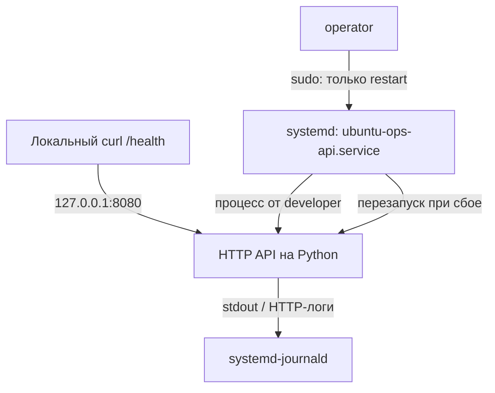

# LAB 01 — Управление сервисом через systemd

## Цель и подтверждённый результат

В этой лабораторной работе мы разворачиваем небольшой HTTP API на Python в Ubuntu Server, запускаем его через systemd без root-привилегий, настраиваем автозапуск после перезагрузки, анализируем логи journald, проверяем ограниченное sudo-правило оператора и демонстрируем автоматическое восстановление после аварийного завершения процесса.

**Подтверждённый результат (14.10.2026):** `ubuntu-ops-api.service` самостоятельно запустился после перезагрузки, ответил на `GET /health` кодом HTTP **200** и восстановился после `SIGKILL` со счётчиком `NRestarts=1`. Пользователю `operator` разрешён перезапуск этого сервиса, но запрещены его остановка и выполнение произвольной команды от root.

## Лабораторное окружение

| Компонент | Конфигурация |
| --- | --- |
| Платформа | VMware Workstation; Ubuntu Server 24.04.5 LTS |
| Виртуальная машина | `ubuntu-ops-01` |
| Python | 3.12.3 (только стандартная библиотека) |
| Имя службы | `ubuntu-ops-api.service` |
| Адрес прослушивания | `127.0.0.1:8080` (только loopback) |
| Health endpoint | `GET /health` |
| Пользователь процесса | `developer`, группа сервиса `app-developers` |
| Пользователь-оператор | `operator` (ограниченный sudo) |
| Установленное приложение | `/srv/ubuntu-ops/app/ubuntu_ops_api.py` |
| Установленный unit | `/etc/systemd/system/ubuntu-ops-api.service` |
| Восстановление | `Restart=on-failure`, `RestartSec=3` |

## Архитектура



API слушает **только локальный интерфейс**. Поэтому для порта 8080 не требуется создавать новое входящее разрешение UFW. Это endpoint для локальных проверок в лаборатории, а не публичный производственный API.

## Структура файлов проекта

| Файл под контролем Git | Назначение |
| --- | --- |
| [`app/ubuntu_ops_api.py`](../app/ubuntu_ops_api.py) | Исходный код HTTP-сервера |
| [`configs/systemd/ubuntu-ops-api.service`](../configs/systemd/ubuntu-ops-api.service) | Версионируемая копия systemd unit |
| [`configs/sudoers/ubuntu-ops-operator`](../configs/sudoers/ubuntu-ops-operator) | Настроенная ранее sudo-политика оператора |
| [`docs/evidence/systemd-operator.txt`](evidence/systemd-operator.txt) | Проверки разрешённых и запрещённых sudo-команд |
| [`docs/evidence/systemd-recovery.txt`](evidence/systemd-recovery.txt) | Результаты восстановления, health check и журналы |

Исходный код и копия unit в Git отличаются от **установленных** файлов в `/srv` и `/etc`. Изменение файла в репозитории само по себе не обновляет запущенный сервис.

## 1. Создание и проверка приложения

Приложение использует `ThreadingHTTPServer` и `BaseHTTPRequestHandler` из стандартной библиотеки Python. Для `GET /health` сервер возвращает HTTP `200` и JSON:

```json
{"status": "ok", "service": "ubuntu-ops-api"}
```

Другие GET-пути возвращают HTTP `404` и `{"error": "not found"}`. Сервер специально слушает `127.0.0.1:8080`; сторонние Python-пакеты не нужны. Синтаксис был проверен через `ast.parse()`.

```bash
cd ~/projects/ubuntu-ops-field-lab
python3 --version
python3 - <<'PY'
import ast
from pathlib import Path
ast.parse(Path('app/ubuntu_ops_api.py').read_text())
print('PASS: Python syntax is valid')
PY
```

## 2. Установка приложения с ограниченными правами

Каталог приложения был создан ранее. Его владелец и группа — `root:app-developers`, права — `2770` (с битом setgid). Установленный файл принадлежит `root:app-developers` и имеет права `0640`.

```bash
sudo install -o root -g app-developers -m 0640 \
  app/ubuntu_ops_api.py /srv/ubuntu-ops/app/ubuntu_ops_api.py
sudo ls -ld /srv/ubuntu-ops/app
sudo ls -l /srv/ubuntu-ops/app/ubuntu_ops_api.py
id developer
sudo -u developer test -r /srv/ubuntu-ops/app/ubuntu_ops_api.py \
  && echo 'PASS: developer can read application'
```

Обычный пользователь `ubuntu` получил `Permission denied` при попытке посмотреть файл без sudo, а `developer` смог прочитать его благодаря членству в группе. Python-скрипт запускается через `/usr/bin/python3`, поэтому root-права для исполнения не требуются.

**Оговорка по безопасности:** режим `2770` разрешает группе изменять содержимое каталога. Участник `app-developers` потенциально может переименовать или заменить файл внутри каталога, даже если сам файл принадлежит root и имеет права `0640`. Для production следует разделять права развёртывания и права запуска; текущую схему нельзя считать защитой от подмены приложения.

## 3. Установка и проверка systemd unit

Сохранённая в Git версия соответствует `/etc/systemd/system/ubuntu-ops-api.service`:

```ini
[Unit]
Description=Ubuntu Ops LAB 01 HTTP API
After=network.target

[Service]
Type=simple
User=developer
Group=app-developers
WorkingDirectory=/srv/ubuntu-ops/app
ExecStart=/usr/bin/python3 /srv/ubuntu-ops/app/ubuntu_ops_api.py
Restart=on-failure
RestartSec=3

NoNewPrivileges=true
PrivateTmp=true
ProtectSystem=strict
ProtectHome=true
Environment=PYTHONDONTWRITEBYTECODE=1

[Install]
WantedBy=multi-user.target
```

`User` и `Group` позволяют запускать приложение без root. `Restart=on-failure` включает повторный запуск после сбоя основного процесса; `RestartSec=3` задаёт задержку. Параметры усиления защиты ограничивают повышение привилегий, работу с временными каталогами и доступ к файловой системе. `PYTHONDONTWRITEBYTECODE=1` запрещает запись Python bytecode в каталог приложения.

На новой лабораторной VM, где пользователь и каталог уже созданы, unit можно установить из репозитория и перечитать конфигурацию systemd:

```bash
sudo install -o root -g root -m 0644 \
  configs/systemd/ubuntu-ops-api.service \
  /etc/systemd/system/ubuntu-ops-api.service
sudo systemd-analyze verify /etc/systemd/system/ubuntu-ops-api.service
sudo systemctl daemon-reload
systemctl show ubuntu-ops-api.service -p LoadState -p User -p Group -p ExecStart
```

В нашей лабораторной `systemd-analyze verify` не вывел ошибок; получены `LoadState=loaded`, `User=developer`, `Group=app-developers`.

## 4. Запуск сервиса и HTTP-проверка

```bash
sudo systemctl start ubuntu-ops-api.service
systemctl is-active ubuntu-ops-api.service
systemctl status ubuntu-ops-api.service --no-pager -l
curl -i --max-time 5 http://127.0.0.1:8080/health
sudo journalctl -u ubuntu-ops-api.service -n 20 --no-pager
```

Получены `active (running)`, ответ HTTP `200 OK`, указанный выше JSON и запись `GET /health ... 200` в журнале. Встроенный Python HTTP-сервер отправляет строку статуса `HTTP/1.0 200 OK`, даже если curl отправляет HTTP/1.1-запрос.

## 5. Автозапуск и проверка после reboot

```bash
sudo systemctl enable ubuntu-ops-api.service
systemctl is-enabled ubuntu-ops-api.service
systemctl is-active ubuntu-ops-api.service
```

Проверки вернули `enabled` и `active`. После `sudo reboot` результат остался тем же: `enabled` и `active`. Локальный `/health` снова ответил HTTP `200`, а `journalctl -b -u ubuntu-ops-api.service` показал запуск службы в новой загрузке **14.10.2026 в 14:37:14 UTC**.

```bash
sudo journalctl -b -u ubuntu-ops-api.service -n 10 --no-pager
```

`start` управляет текущим процессом, а `enable` настраивает запуск при загрузке. Это разные операции.

## 6. Минимально необходимые sudo-привилегии оператора

Созданное ранее правило sudoers разрешает **строго определённую команду**, включая полный путь и имя сервиса:

```sudoers
operator ALL=(root) NOPASSWD: /usr/bin/systemctl restart ubuntu-ops-api.service
```

У `operator` нет общего административного sudo-доступа. В практической проверке пользователь успешно перезапустил API, и `/health` продолжил отвечать. Следующие проверки выполнены в **режиме просмотра разрешений** (`sudo -l`), без запуска исследуемых команд:

```bash
sudo -l -U operator
sudo -u operator sudo -n -l /usr/bin/systemctl restart ubuntu-ops-api.service
echo "Restart permission exit code: $?"  # 0
sudo -u operator sudo -n -l /usr/bin/systemctl stop ubuntu-ops-api.service
echo "Stop permission exit code: $?"     # 1
sudo -u operator sudo -n -l /usr/bin/id
echo "Root command permission exit code: $?"  # 1
```

| Проверка | Полученный код | Значение |
| --- | ---: | --- |
| Перезапуск нашего API | `0` | Разрешено |
| Остановка нашего API | `1` | Запрещено |
| Запуск `/usr/bin/id` от root | `1` | Запрещено |

Полный вывод находится в [`systemd-operator.txt`](evidence/systemd-operator.txt). Мы подтвердили права для конкретных проверенных команд — это не формальное доказательство отсутствия любых способов повышения привилегий.

## 7. Симуляция сбоя и автоматическое восстановление

Это **контролируемый эксперимент в лаборатории**, а не рекомендация для production-сервиса. Мы отправили работающему Python-процессу сигнал `SIGKILL`:

```bash
systemctl show -p MainPID --value ubuntu-ops-api.service
sudo systemctl kill --kill-whom=main --signal=SIGKILL ubuntu-ops-api.service
sleep 5
systemctl is-active ubuntu-ops-api.service
systemctl show -p MainPID -p NRestarts ubuntu-ops-api.service
curl -i --max-time 5 http://127.0.0.1:8080/health
sudo journalctl -u ubuntu-ops-api.service -n 20 --no-pager
```

Хронология событий (UTC, 14.10.2026):

| Время | Событие |
| --- | --- |
| `14:45:44` | systemd отправил `SIGKILL` процессу `1432`; журнал показал `status=9/KILL` и ошибку `signal` |
| `14:45:47` | systemd запланировал и выполнил автоперезапуск; новый PID `1473` |
| `14:46:04` | Запрос `/health` успешно вернул HTTP `200` |

После эксперимента получены `active`, `MainPID=1473`, `NRestarts=1`. Интервал в три секунды — **наблюдаемое время до нового запуска процесса**, а не гарантия времени восстановления для клиентов. В evidence сохранены сообщения журнала и последующий успешный health check.

## Диагностика и рабочие команды

```bash
systemctl status ubuntu-ops-api.service --no-pager -l
sudo journalctl -b -u ubuntu-ops-api.service -n 50 --no-pager
systemctl show -p MainPID -p NRestarts ubuntu-ops-api.service
curl -i --max-time 5 http://127.0.0.1:8080/health
sudo systemd-analyze verify /etc/systemd/system/ubuntu-ops-api.service
```

Если служба не запускается, проверь права `developer` на проход в каталог и чтение скрипта, занятость порта 8080, пути к интерпретатору и приложению в `ExecStart`. После изменения unit нужен `sudo systemctl daemon-reload`; после изменения кода — повторное развёртывание файла и перезапуск службы.

## Ограничения и замечания по безопасности

- Приложение намеренно минимальное: без аутентификации, TLS, rate limiting, дополнительных проверок готовности и метрик. Для production оно не предназначено.
- Прослушивание loopback ограничивает доступ по сети, но не делает API доверенным для всех локальных пользователей.
- Автоматический перезапуск повышает устойчивость, но не заменяет мониторинг, оповещения, поиск причины сбоя и возможность отката.
- Группа `app-developers` может изменять каталог приложения. В production следует разделить роли развёртывания и выполнения.
- Sudoers разрешает только заданный restart. При изменении команды, unit или задач оператора политику необходимо пересмотреть.

## Evidence и статус

| Файл | Содержание |
| --- | --- |
| [`docs/evidence/systemd-operator.txt`](evidence/systemd-operator.txt) | Список sudo-разрешений и коды трёх проверок |
| [`docs/evidence/systemd-recovery.txt`](evidence/systemd-recovery.txt) | `enabled`, `active`, PID, счётчик перезапусков, HTTP-ответ, сообщения о восстановлении |

**Статус:** HTTP health check, запуск через systemd, сохранение автозапуска после reboot, Least Privilege для оператора и восстановление после `SIGKILL` — **PASS**.
